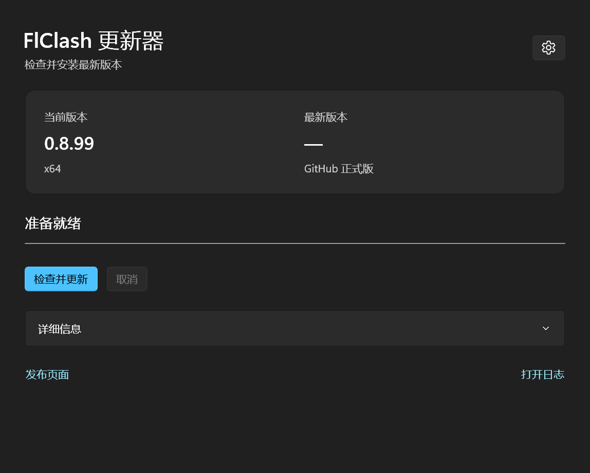

# FlClash Updater

Check for new FlClash releases and install updates on Windows or macOS.

## Windows

[Download](https://github.com/kowyo/flclash-updater/releases/latest)



## macOS

`fu` updates `/Applications/FlClash.app` to the latest official stable release on Apple Silicon and Intel Macs.

### Requirements

- `uv` on your `PATH`. It selects a compatible Python version (3.11 or newer) during installation.
- Write access to `/Applications` and the existing FlClash app.

### Install

Install directly from GitHub:

```sh
uv tool install git+https://github.com/kowyo/flclash-updater.git
```

If `fu` is not on your `PATH`, run `uv tool update-shell` and restart your terminal.

To install from a local checkout, run `uv tool install .` in the repository root.

To update the updater itself, run `uv tool upgrade flclash-updater`.

### Usage

Run as your normal user:

```sh
fu
```

For help, run `fu --help`.

The command selects the installer for your Mac, verifies its SHA-256 checksum against the official GitHub release, replaces the app, and launches it. Proxy connections briefly disconnect during the update. If FlClash is already up to date, the command exits without restarting it.

Successful updates remove the old app and temporary installation files. Subscriptions, settings, rules, and caches remain in the user data directory. If replacing or launching the app fails, the command attempts to restore the previous app.
